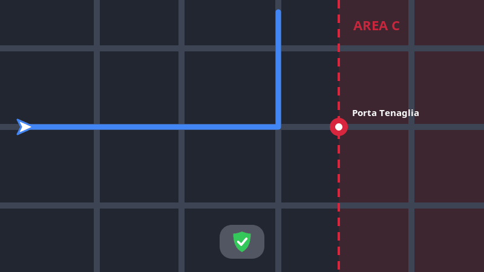

<p align="center"></p>

# ZTLive

[English](README.md) · **Italiano**

App iOS che avvisa quando ti avvicini a un varco ZTL di Milano (Area C, Area B, ZTL locali) mentre navighi con Google Maps, in auto o in moto.

Gli avvisi arrivano come **Live Activity**, visibile su CarPlay, schermata di blocco e Dynamic Island, e opzionalmente a voce.

<p align="center"></p>
<p align="center"><sub>Animazione dimostrativa: avvicinandosi a un varco di Area C l'avviso diventa arancione e poi rosso; svoltando prima del varco torna via libera.</sub></p>

## Funzioni

- **Varchi di Area C e Area B** dagli open data del Comune di Milano: avviso circa 400 m prima del varco nella direzione di marcia, livello "imminente" sotto i 120 m.
- **ZTL locali e aree pedonali** (Brera, Sarpi, Navigli, Ticinese…): avviso quando la direzione di marcia porta dentro la zona, fino a 300 m prima.
- **Orari**: Area B e C nei feriali 7:30–19:30, festivi esclusi (nazionali e Sant'Ambrogio). Per ZTL e aree pedonali valgono gli orari riportati nelle note del dataset; dove mancano la zona è considerata sempre attiva.
- **Auto o moto**: in moto si ignorano l'Area C e le zone in cui le deroghe ammettono le moto. Il veicolo viene riconosciuto dal dispositivo collegato (CarPlay, interfono) dopo averlo scelto una volta.
- **Live Activity** colorata (arancione in avvicinamento, rosso se imminente), visibile su CarPlay anche sopra Google Maps; a strada libera si riduce a un piccolo scudo verde.
- **Avvisi vocali** opzionali, che abbassano per un attimo la navigazione o la musica.
- **Controllo del percorso prima di partire**: condividi un percorso da Google Maps a ZTLive (Condividi → ZTLive) o incollane il link nella scheda *Percorso*. ZTLive lo ricalcola con Apple Maps, elenca le zone attraversate con l'orario stimato di passaggio e, se un'alternativa di Apple Maps le evita, riapre Google Maps con tappe che la seguono.
- **Simulazione** per provare Live Activity e CarPlay da fermi.

Verificato su iPhone 15 Pro Max con iOS 27.0.1: aggiornamento in background con Google Maps aperto, CarPlay in auto e sul TFT di una Honda Africa Twin (audio nel casco con interfono collegato).

## Struttura

| Percorso | Contenuto |
|---|---|
| `Packages/ZTLCore` | Logica pura (geometria, varchi, orari), testata anche su Linux |
| `App` | App SwiftUI: GPS in background, Live Activity, voce |
| `Widget` | Estensione con la grafica della Live Activity |
| `RouteCheck` | Controllo percorso (link di Google Maps → percorsi Apple Maps → zone attraversate), condiviso da app ed estensione di condivisione |
| `ShareExtension` | Estensione "Condividi → ZTLive" che riceve i percorsi da Google Maps |
| `Shared` | Modello dati condiviso tra app ed estensione |
| `Resources` | Varchi (GeoJSON del Comune) e zone locali (`zone_locali.json`) |
| `tools/make_artwork.py` | Rigenera icona, logo e GIF dimostrativa |
| `tools/build_zone_data.py` | Rigenera `zone_locali.json` dal dataset ds51, con orari ed esclusioni |
| `project.yml` | Definizione del progetto per XcodeGen |

## Build

Non serve un Mac: ogni push su `main` compila l'app su GitHub Actions. L'IPA non firmata viene pubblicata nella release [`prototype`](../../releases/tag/prototype).

I test della logica si possono eseguire ovunque ci sia Swift:

```sh
swift test --package-path Packages/ZTLCore
```

## Installazione con SideStore

1. Installa [SideStore](https://sidestore.io) sull'iPhone seguendo la guida ufficiale. La configurazione iniziale richiede un computer, anche Linux.
2. Dall'iPhone scarica `ZTLive.ipa` dalla release `prototype`.
3. In SideStore: **My Apps → +** e scegli il file scaricato.
4. SideStore rinnova la firma ogni 7 giorni in automatico.
5. Al primo avvio concedi la posizione. Controlla anche che le Live Activity siano attive in Impostazioni → ZTLive.

## Dati

Fonte: [Portale Open Data del Comune di Milano](https://dati.comune.milano.it), licenza CC BY 4.0.

- [Varchi Area C](https://dati.comune.milano.it/dataset/ds82_infogeo_varchi_elettronici_localizzazione_) (ds82)
- [Varchi Area B](https://dati.comune.milano.it/dataset/ds959-varchi-areab) (ds959)
- [Aree pedonali e ZTL](https://dati.comune.milano.it/dataset/ds51_trafficotrasporti_aree_pedonali_ztl) (ds51)

Per aggiornare le zone locali: `python3 tools/build_zone_data.py`.

Le informazioni hanno valore indicativo: fanno fede la segnaletica e gli atti ufficiali del Comune.
